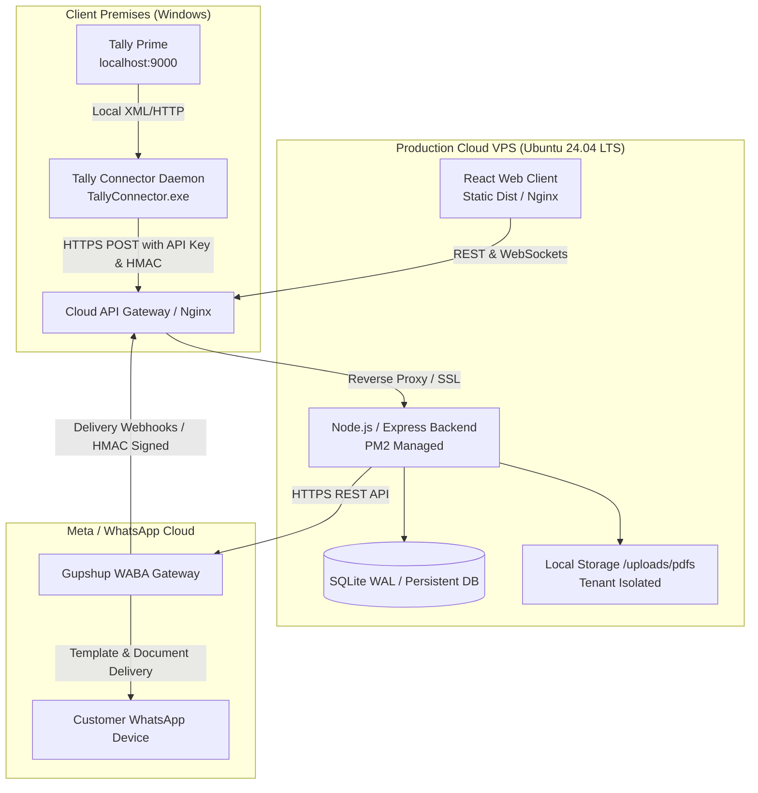

# Production Hosting & Architecture Deployment Proposal
**Project:** WhatsApp Ledger Automation System (WABA + Tally Connector + Express + React)  
**Version:** 2.0 (Official Meta WABA & Tally Prime Architecture)  
**Date:** October 2026  

---

## 1. Executive Summary

This proposal outlines the production infrastructure, deployment topology, and hosting recommendations for the **WhatsApp Ledger Automation System**. 

The system has been modernized from legacy browser-based WhatsApp Web scraping (`whatsapp-web.js` / Puppeteer) to the **Official WhatsApp Business API (WABA via Gupshup Enterprise REST API)** paired with a **Local Windows Tally Connector daemon**.

### Key Architectural Shifts:
- **No Headless Chromium Required in Production:** Dispatches utilize official Meta WABA REST endpoints, eliminating browser memory crashes, QR-code re-scanning, and session disconnections.
- **SSRF-Free Local Tally Ingestion:** Local accounting data is extracted securely on client Windows machines by `TallyConnector.exe` and pushed over authenticated HTTPS to the cloud API.
- **Lightweight, High-Density Hosting:** Without headless Chrome RAM requirements, a cost-effective VPS (1–2 vCPUs, 2–4 GB RAM) supports thousands of daily ledger transmissions effortlessly.

---

## 2. Production System Architecture



### Component Breakdown:
1. **Frontend Dashboard:** React SPA (Vite) providing multi-tenant invoice matching, ledger reconciliation, send queue controls, billing analytics, and audit log exploration.
2. **Cloud Backend Server:** Node.js Express service running behind Nginx. Manages tenant accounts, signed HMAC PDF downloads, rate-limited queues, SQLite multi-company storage, and Gupshup WABA dispatching.
3. **Windows Tally Connector:** Standalone Windows background daemon (`connector/tally_connector.py` / PyInstaller executable) installed on the client machine running Tally Prime. Extracts ledger balances and transaction rows, generates signed verification digests, and uploads payloads securely to `/api/tally/upload-ledgers`.
4. **Meta WhatsApp Business API (Gupshup):** Official Cloud API delivering verified PDF document templates with real-time status callbacks (Sent, Delivered, Read, Failed).

---

## 3. Why the Legacy Architecture Was Retired

| Legacy Scraper Architecture (`whatsapp-web.js`) | Official WABA & Connector Architecture (Current) |
| :--- | :--- |
| **High Memory Footprint:** Headless Chromium required 1–2 GB RAM per instance, leading to Out-Of-Memory (OOM) crashes on low-tier servers. | **Ultra-Low Memory:** Pure REST and lightweight PDF streaming require < 150 MB RAM total. |
| **Session Loss:** Inactivity, IP changes, or server restarts terminated the session, demanding manual QR-code re-scans. | **Perpetual Authorization:** API tokens and service credentials remain valid permanently without manual human intervention. |
| **Meta Policy Risk:** Unofficial scraping violated WhatsApp Terms of Service, risking permanent phone number bans. | **100% Policy Compliant:** Official Meta WABA integration ensures zero risk of account bans or delivery blocks. |
| **Intranet SSRF Hazard:** Cloud server attempted to connect to `localhost:9000`, vulnerable to SSRF. | **Local Push Model:** Cloud server never makes outbound intranet requests. Local Windows Connector securely pushes data outwards over TLS. |

---

## 4. Hardware & Infrastructure Sizing

Because headless browser emulation has been completely eliminated from the message dispatch pipeline, production server resource requirements are substantially reduced:

| Component | Minimum Specification | Recommended Specification |
| :--- | :--- | :--- |
| **vCPU Cores** | 1 vCPU | **2 vCPUs** |
| **Memory (RAM)** | 2 GB | **4 GB** (8 GB for multi-tenant heavy batches) |
| **Storage** | 25 GB NVMe SSD | **50–100 GB NVMe SSD** |
| **Bandwidth** | 1 TB / month | **2–4 TB / month** |
| **Operating System** | Ubuntu 22.04 LTS (64-bit) | **Ubuntu 24.04 LTS (64-bit)** |

---

## 5. Hosting Provider Comparison & Recommendations

### Option 1: Hostinger KVM 2 VPS (Recommended for Value)
- **Specs:** 2 vCPUs, 8 GB RAM, 100 GB NVMe SSD, 8 TB Bandwidth, Dedicated IPv4.
- **Pricing:** ~$11.78 / month (annual commitment).
- **Pros:** Exceptional price-to-performance ratio, automated daily snapshots, unified DNS & SSL management, dedicated static IP.
- **Verdict:** **Top recommendation** for small-to-medium enterprise rollouts.

### Option 2: DigitalOcean / Hetzner Cloud (Recommended for DevOps Teams)
- **DigitalOcean Basic Droplet:** 2 vCPUs, 4 GB RAM, 80 GB SSD (~$24 / month).
- **Hetzner Cloud CPX21:** 3 vCPUs, 4 GB RAM, 80 GB NVMe (~€8.50 / month).
- **Pros:** Fast provisioning, floating IPs, granular firewall rules, robust API.

### Option 3: AWS Lightsail
- **Specs:** 2 vCPUs, 4 GB RAM, 80 GB SSD (~$20 / month).
- **Pros:** Integrated AWS VPC peering, managed SSL certificates, simple upgrade path to EC2/RDS.

---

## 6. Security, Hardening & Operational Invariants

To maintain production readiness and data protection compliance:

1. **Strict Transport Security (TLS 1.3):** All public endpoints must terminate TLS via Nginx with Let's Encrypt certificates. HTTP traffic is unconditionally redirected to HTTPS.
2. **AES-256-GCM Encryption at Rest:** Sensitive provider API keys, webhook signing secrets, and connector tokens are encrypted with authenticated ciphers before persistence.
3. **Signed HMAC PDF URLs:** Direct filesystem paths are never exposed. Media files are downloaded by WhatsApp servers using cryptographic URLs with 15-minute expiration bound to `pdfId` and `company_id`.
4. **Idempotent Webhook Ingestion:** Gupshup status webhooks are validated with HMAC-SHA256 signatures and processed idempotently to prevent duplicate updates or out-of-order state regression.
5. **Automated PDF Retention Cleanup:** A configurable retention engine (`PDF_RETENTION_DAYS`) automatically unlinks expired PDFs and removes stale database records, reclaiming disk space without administrative overhead.
6. **Immutable Audit Logging:** All security operations, settings alterations, batch approvals, and dispatches are appended to a tamper-resistant audit trail.

---

## 7. Step-by-Step Production Deployment Guide

### Phase 1: Server Provisioning
```bash
# Update Ubuntu packages
sudo apt update && sudo apt upgrade -y

# Install Node.js 20 LTS & Build Essentials
curl -fsSL https://deb.nodesource.com/setup_20.x | sudo -E bash -
sudo apt install -y nodejs nginx certbot python3-certbot-nginx git build-essential

# Install PM2 Process Manager globally
sudo npm install -g pm2
```

### Phase 2: Application Deployment
```bash
# Clone repository
git clone <repository_url> /var/www/whatsapp-ledger
cd /var/www/whatsapp-ledger

# Install root & server dependencies
npm install --prefix server
npm install --prefix client

# Build production React frontend bundle
npm run build --prefix client

# Configure environment variables
cp server/.env.example server/.env
nano server/.env
```

### Phase 3: Nginx & SSL Configuration
Create `/etc/nginx/sites-available/whatsapp-ledger`:
```nginx
server {
    server_name app.yourdomain.com;

    # React Static Bundle
    location / {
        root /var/www/whatsapp-ledger/client/dist;
        try_files $uri $uri/ /index.html;
    }

    # API Proxy
    location /api/ {
        proxy_pass http://127.0.0.1:5000;
        proxy_http_version 1.1;
        proxy_set_header Host $host;
        proxy_set_header X-Real-IP $remote_addr;
        proxy_set_header X-Forwarded-For $proxy_add_x_forwarded_for;
        proxy_set_header X-Forwarded-Proto $scheme;
    }

    # Socket.IO WebSocket Proxy
    location /socket.io/ {
        proxy_pass http://127.0.0.1:5000;
        proxy_http_version 1.1;
        proxy_set_header Upgrade $http_upgrade;
        proxy_set_header Connection "upgrade";
        proxy_set_header Host $host;
    }
}
```

```bash
# Enable Nginx site and obtain SSL certificate
sudo ln -s /etc/nginx/sites-available/whatsapp-ledger /etc/nginx/sites-enabled/
sudo nginx -t && sudo systemctl reload nginx
sudo certbot --nginx -d app.yourdomain.com
```

### Phase 4: PM2 Process Management
```bash
cd /var/www/whatsapp-ledger/server
pm2 start server.js --name "whatsapp-ledger-api" -i max
pm2 save
pm2 startup
```

### Phase 5: Client Windows Connector Setup
1. On each client workstation running Tally Prime (port 9000), install `TallyConnector.exe` or python script.
2. Generate an authorized Connector API Key in the web dashboard under **Tally Settings**.
3. Configure `config.json` with the cloud API URL (`https://app.yourdomain.com`) and connector key.
4. Run connector as a Windows Service (via NSSM or Windows Task Scheduler) for continuous automated synchronization.
